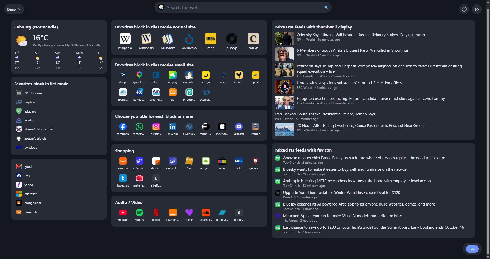
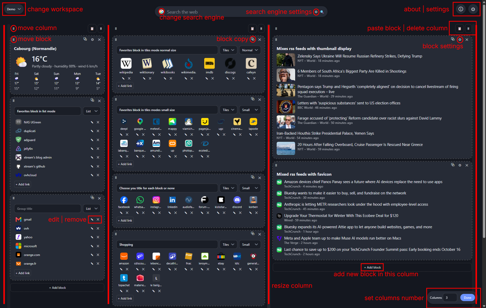
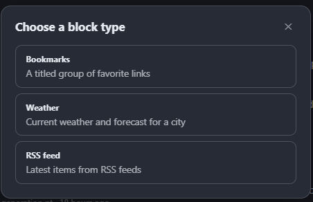
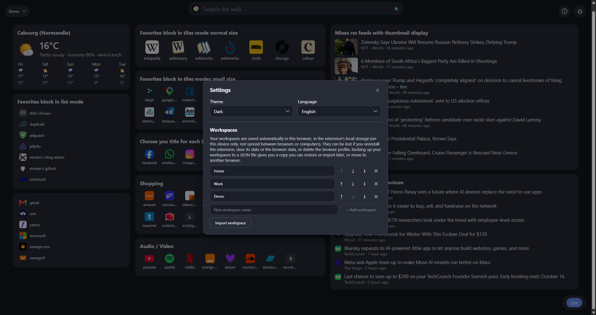
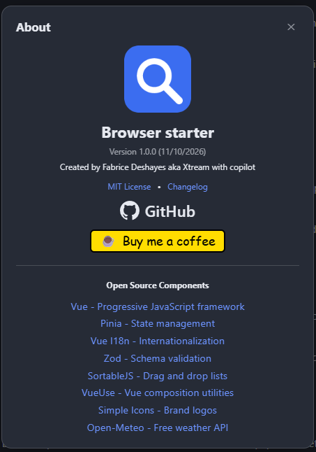

# Browser starter

A customizable start page / new tab for your browser: a multi-engine search bar and a free-form layout of columns and blocks. 
Compatible with chromium-based browsers (Chrome, Edge, Vivaldi, Brave...) and Firefox.
Everything is stored locally; no account, no server, no ads.
Open source, MIT license. See [PRIVACY.md](PRIVACY.md) for details.

## Features

- **Search bar** – Google by default; click the logo to switch to DuckDuckGo, Bing, Perplexity, YouTube, IMDb, Amazon, Wikipedia, GitHub, or add your own engine.
- **Customizable layout** – any number of columns (1–8), resizable widths, blocks you can reorder, move between columns. View mode by default, edit mode on demand.
- **Blocks**
  - *Bookmarks*: titled groups of links, automatic favicon or your own uploaded icon, drag to reorder.
  - *Weather*: current conditions and forecast for a city ([Open-Meteo](https://open-meteo.com/), no API key). Optional (block settings): use the browser position (asks for
    permission; the place is named with [OpenStreetMap Nominatim](https://nominatim.openstreetmap.org/), the chosen city being the fallback), rain in the next hour (4 × 15 min
    grid,
    colored by intensity) and sunrise/sunset (as a sentence) with the moon phase.
  - *News*: mix several RSS/Atom feeds of your choice in a single merged view, choose how many items to display, with thumbnails, favicons or nothing. Add feeds from predefined lists per language (French, English) grouped by category (news, science, technology, business, sports, culture), or add a custom feed by URL and name.
- **Workspaces** – create as many workspaces as you like, each with its own layout and blocks, e.g. one start page for home and another for work.
- **Backup** – export/import each workspace as JSON.
- Light, dark or automatic theme; English and French.

## Screenshots

### Overview


The start page in view mode: search bar, and your columns of bookmarks, weather and news blocks.

### Edit mode


Edit mode lets you reorder blocks, move them between columns and resize columns and blocks.

### Adding a block


Add a bookmarks, weather or news block to any column.

### Settings


Configure theme, language and workspaces.

### About


Version information and project links.

## Install

Download the latest zip from the releases page, or build it yourself:

```bash
npm install
npm run build:extension
```

- **Chrome / Edge / Vivaldi / Brave**: open `chrome://extensions` (or `edge://extensions`, `vivaldi://extensions`), enable developer mode, "Load unpacked" and select `build/chromium`.
- **Firefox**: open `about:debugging#/runtime/this-firefox`, "Load Temporary Add-on" and select `build/firefox/manifest.json`. Firefox may require granting the "access to all sites" permission manually (needed to read RSS feeds and favicons).

This extension replaces your browser home page.

## Development

```bash
npm run dev        # dev server (data kept in localStorage)
npm test           # unit tests
npm run lint
npm run type-check
npm run build:extension
```

Requires Node.js `^22.18` or `>=24.12`. See [CONTRIBUTING.md](CONTRIBUTING.md) and [PRIVACY.md](PRIVACY.md).

## Stack

Vue 3, TypeScript, Vite, Pinia, Zod, vue-i18n, VueUse, SortableJS, Simple Icons, tldts, Vitest, Playwright.

## Open source components and services

- [Vue](https://vuejs.org), [Pinia](https://pinia.vuejs.org), [Vue I18n](https://vue-i18n.intlify.dev), [VueUse](https://vueuse.org)
- [Zod](https://zod.dev): schema validation
- [SortableJS](https://sortablejs.github.io/Sortable): drag and drop
- [Simple Icons](https://simpleicons.org): brand logos
- [tldts](https://github.com/remusao/tldts): domain name parsing
- [Open-Meteo](https://open-meteo.com): weather and geocoding API (no API key)
- [OpenStreetMap Nominatim](https://nominatim.openstreetmap.org): reverse geocoding of the browser position

## License

[MIT](LICENSE). Brand logos are trademarks of their respective owners and are used only to identify the search engines.