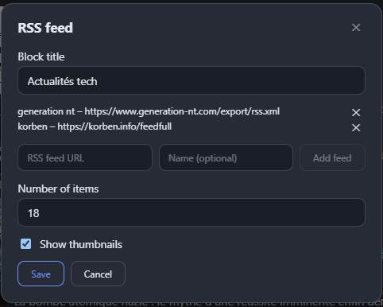

# Browser starter

A customizable start page / new tab for your browser: a multi-engine search bar and a free-form layout of columns and blocks. Everything is stored locally; no account, no server, no ads.

## Features

- **Search bar** – Google by default; click the logo to switch to DuckDuckGo, Bing, Perplexity, YouTube, IMDb, Amazon, Wikipedia, GitHub, or add your own engine.
- **Customizable layout** – any number of columns (1–8), resizable widths, blocks you can reorder, move between columns and resize in height. View mode by default, edit mode on demand.
- **Blocks**
  - *Bookmarks*: titled groups of links, automatic favicon or your own uploaded icon, drag to reorder.
  - *Weather*: current conditions and forecast for a city ([Open-Meteo](https://open-meteo.com/), no API key).
  - *News*: mix several RSS/Atom feeds of your choice in a single merged view, choose how many items to display, with or without thumbnails.
- **Workspaces** – create as many workspaces as you like, each with its own layout and blocks, e.g. one start page for home and another for work.
- **Backup** – export/import the whole configuration as JSON.
- Light, dark or automatic theme; English and French.

## Screenshots

### Overview


The start page in view mode: search bar, and your columns of bookmarks, weather and news blocks.

### Edit mode


Edit mode lets you reorder blocks, move them between columns and resize columns and blocks.

### Adding a block


Add a bookmarks, weather or news block to any column.

### Mixing RSS feeds


Combine several RSS/Atom feeds into a single merged news block.

### Settings


Configure workspaces, theme, language and configuration backup/import.

### About


Version information and project links.

## Install

Download the latest zip from the releases page, or build it yourself:

```bash
npm install
npm run build:extension
```

- **Chrome / Edge / Vivaldi / Brave**: open `chrome://extensions` (or `edge://extensions`, `vivaldi://extensions`), enable developer mode, "Load unpacked" and select `build/chromium`.
- **Firefox**: open `about:debugging#/runtime/this-firefox`, "Load Temporary Add-on" and select `build/firefox/manifest.json`. Firefox may require granting the "access to all sites" permission manually (needed to read RSS feeds and favicons).

The extension replaces the new tab page. To use it as your home page too, set your browser's home page to the extension's new tab URL.

## Development

```bash
npm run dev        # dev server (data kept in localStorage)
npm test           # unit tests
npm run lint
npm run type-check
npm run build:extension
```

Requires Node.js `^22.18` or `>=24.12`. See [CONTRIBUTING.md](CONTRIBUTING.md) and [PRIVACY.md](PRIVACY.md).

## Stack

Vue 3, TypeScript, Vite, Pinia, Zod, vue-i18n, SortableJS, Vitest, Playwright.

## License

[MIT](LICENSE). Brand logos are trademarks of their respective owners and are used only to identify the search engines.